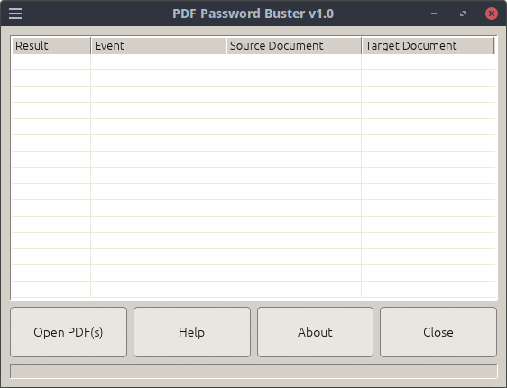

<h1 align="center">PDF Password Buster</h1>

<p align="center">
  
  
  
</p>

A free and open-source desktop application, written in Rust, that removes passwords and
restrictions from PDF files. It runs natively on **Linux, Windows and macOS** and needs no
registration, serial number or activation key.



## What it does

- **Removes restrictions** (printing, copying text, editing, annotations) from PDFs that open
  without a password. Nothing needs to be typed, and a wrongly typed password does not get in the
  way: the empty password is always tried first.
- **Removes the opening password** when you know it. Either the user or the owner password works.
- Asks for the password only when a file needs one, and tries the last password you typed on the
  next files of the same session.
- Processes several files at once (Open PDF(s) or drag and drop). One file: you choose the name of
  the new copy. Several files: you choose an output folder and the names are kept.
- Writes through a temporary file, so a failure never leaves a broken PDF, and replacing the
  original in place is safe.
- Keeps every page, string, stream, attachment and metadata of the document, decrypted.
- Shows each file's result in a list (SUCCEED, ERROR or FAILED). Right-click an entry to open the
  original or the new document, or to clear entries.
- Also works from the command line, for batches and scripts.

### Supported encryption

The PDF Standard security handler, revisions 2 to 6:

| Encryption | PDF / Acrobat |
|---|---|
| RC4 40-bit | PDF 1.1+ |
| RC4 128-bit (V2 and V4 crypt filters) | PDF 1.4+ |
| AES 128-bit | PDF 1.6 / Acrobat 7 |
| AES 256-bit, revision 5 | Acrobat 9 (Adobe extension level 3) |
| AES 256-bit, revision 6 | PDF 2.0 / Acrobat X+ |

It also handles unencrypted metadata (`/EncryptMetadata false`), compressed object and
cross-reference streams, damaged cross-reference tables, Unicode passwords, and AES-256 files
whose `/Perms` entry is missing or damaged (it is checked against the password and repaired in
memory; the file on disk is never changed).

## What it does NOT do

It does not guess or crack unknown passwords: a file that needs an opening password can only be
unlocked if you provide it. Files protected with certificates (public-key security) instead of
passwords are not supported. Use it only on files you own or are allowed to unlock.

Removing the encryption invalidates the document's digital signatures.

## Command line

The same text is shown by `pdf-password-buster -h` and at the end of the program's Help window:

```text
Usage: pdf-password-buster [options]
 -i [pdf file name] : PDF filename or directory to be decrypted.
 -o [pdf file name] : Output PDF filename or directory. If you do not
                      specify -o, the output overwrites the input PDF
                      file.
 -u                 : User password.
 -w                 : Owner password.
 -v                 : View the decrypted PDF file after decryption.
 -l [log file name] : Specify log file for output message.
 -? or -h           : Help.
```

Examples:

```bash
pdf-password-buster -i ~/sample.pdf -o ~/decrypt.pdf \
    -w owner -u user -l ~/error.log
pdf-password-buster -i ~/sample.pdf
pdf-password-buster -i ~/sample.pdf -o ~/out.pdf -w "owner password"
pdf-password-buster -i ~/sample.pdf -o ~/out.pdf -u "user password"
pdf-password-buster -i ~/pdfdir/ -o ~/outdir/ -l ~/error.log
```

PDF files given without options open the window with those files already being processed:
`pdf-password-buster a.pdf b.pdf --output-dir out/`.

The exit code is 0 when every file was unlocked and 2 when at least one failed.

## Building

You need a recent stable [Rust](https://www.rust-lang.org/tools/install) (the project
uses the 2024 edition). Then, in this folder:

```bash
cargo build --release
```

The program is written to `target/release/pdf-password-buster` (`.exe` on Windows).

### Linux

Install the GTK 3 development files (used for the file dialogs) and the usual windowing libraries:

```bash
# Debian / Ubuntu
sudo apt install build-essential libgtk-3-dev libxkbcommon-dev libwayland-dev
# Fedora
sudo dnf install gcc gtk3-devel libxkbcommon-devel wayland-devel
# Arch
sudo pacman -S base-devel gtk3 libxkbcommon wayland
```

Optional, to add it to the applications menu with its icon:

```bash
install -Dm755 target/release/pdf-password-buster ~/.local/bin/pdf-password-buster
install -Dm644 assets/pdf-password-buster.desktop ~/.local/share/applications/pdf-password-buster.desktop
for s in 32 48 64 128 256; do
  install -Dm644 assets/icons/pdf-password-buster-$s.png \
    ~/.local/share/icons/hicolor/${s}x${s}/apps/pdf-password-buster.png
done
```

### Windows

Install Rust with `rustup` and the **Visual Studio Build Tools** (the "Desktop development with
C++" workload) when the installer asks for them. `cargo build --release` produces
`pdf-password-buster.exe` with the program icon embedded. Release builds open no console window;
when started from a terminal with command line options, messages are printed in that terminal.

### macOS

Install the Xcode command line tools (`xcode-select --install`) and Rust. `cargo build --release`
produces a command line binary that also opens the window. To make a regular `.app` with the
icon:

```bash
cargo install cargo-bundle
cargo bundle --release
# target/release/bundle/osx/PDF Password Buster.app
```

The app is not signed, so the first time macOS may ask you to open it with right-click, Open.

### Automatic builds

`.github/workflows/build.yml` builds the program on Linux, Windows and macOS with GitHub Actions
(on every push, when this folder is the root of a GitHub repository) and keeps the three
binaries as downloadable artifacts.

## Code structure

- `src/main.rs`: entry point, options and platform helpers.
- `src/app.rs`: the window (result list, buttons, password prompt, About, Help).
- `src/engine.rs`: opening, decrypting and saving PDFs.
- `src/perms_repair.rs`: password check and `/Perms` repair for AES-256 files.
- `src/cli.rs`: command line mode.
- `build.rs`: embeds the icon in the Windows executable.
- `assets/`: icons and the Linux desktop entry.

## Dependencies

- [lopdf](https://github.com/J-F-Liu/lopdf) (MIT): PDF reading, decryption and writing.
- [egui / eframe](https://github.com/emilk/egui) and egui_extras (MIT or Apache-2.0): user interface.
- [rfd](https://github.com/PolyMeilex/rfd) (MIT): native file dialogs.
- [RustCrypto](https://github.com/RustCrypto) `aes` and `sha2` (MIT or Apache-2.0): `/Perms` repair.
- [png](https://github.com/image-rs/image-png) (MIT or Apache-2.0): icon and screenshots.

## Copying

Copyright 2026 Daniel Dias Rodrigues. Licensed under the [MIT License](LICENSE).
